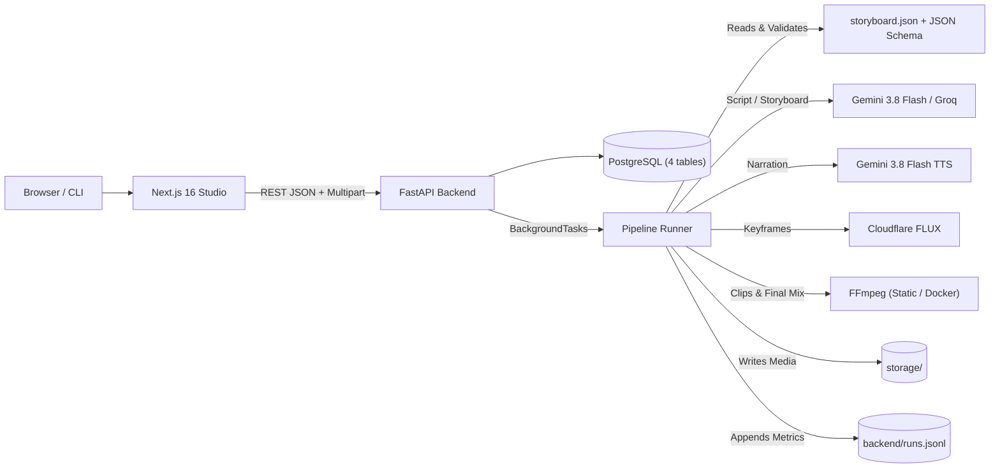
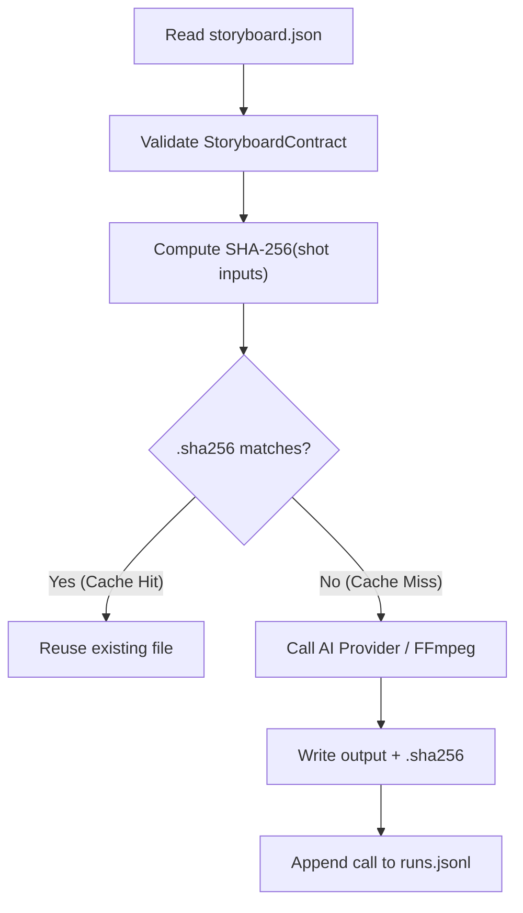
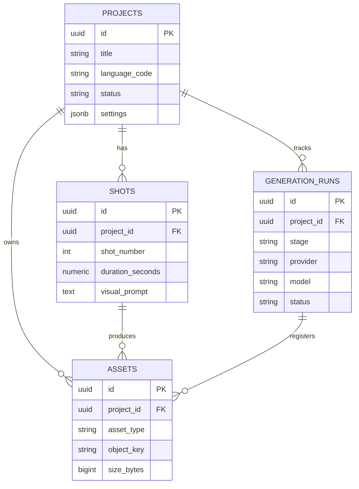

# System Architecture

## 1. High-Level System Diagram

---

## 2. Pipeline Contract & SHA-256 Caching

Every stage reads the validated `storyboard.json` contract (`schema/storyboard.schema.json`) and computes a deterministic SHA-256 digest of its inputs before calling any model.

Editing one shot in `storyboard.json` invalidates only that shot's `.sha256` file; all other shots are skipped.

---

## 3. Data Model (PostgreSQL)

---

## 4. Failure Handling & Fallbacks

| Stage | Primary | Failure Mode | Fallback / Recovery |
|---|---|---|---|
| Script & Storyboard | `gemini-3.8-flash` | HTTP `503` / `429` | Exponential backoff (3 retries), then Groq `openai/gpt-oss-120b` |
| Keyframes | `@cf/black-forest-labs/flux-1-schnell` | `400` / quota | Automatic fallback to `@cf/black-forest-labs/flux-2-klein-4b` |
| Narration | `gemini-3.8-flash-tts` | `429` RPM/daily limit | `6s` pacing + `20s/40s` backoff; timed silence WAV on exhaustion |
| Moving Shots | Wan 2.2 TI2V-5B | GPU quota / missing clip | FFmpeg `zoompan` Ken Burns motion at 24 fps |
| Music Score | ACE-Step 1.5 | Missing score file | FFmpeg ambient sine pad (`generate_ambient_score`) |
| Assembly | Local `ffmpeg` | Binary not on host PATH | Automatic Docker fallback via `mwader/static-ffmpeg:7.1` |

---

## 5. Observability

- Every model call logs `ts`, `stage`, `model`, `params`, `seed`, `latency_ms`, `cost_usd`, `status`, and sanitized `note` (`key=***`) to `backend/runs.jsonl`.
- API runs record lifecycle state (`running` → `succeeded` / `failed`) in `generation_runs`.
